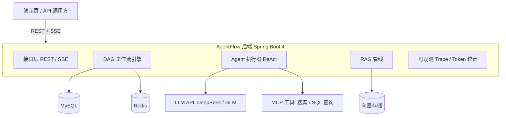

# AgentFlow · 轻量级多 Agent 工作流平台

用 JSON DSL 定义工作流（LLM 节点、工具节点、知识库检索节点、条件分支），后端以**自研 DAG 引擎**流式执行，支持自研 Agent 循环（ReAct / Function Calling）、RAG（混合检索 + 引用溯源）与 MCP 工具接入。

> **简历一句话（目标态，做完对应阶段再更新）**：基于 Spring Boot 4 / JDK 21 构建多 Agent 工作流平台：自研 DAG 执行引擎（节点并发调度、超时重试、checkpoint 恢复），自实现 ReAct Agent 循环与 Function Calling，RAG 管线（混合检索 + Rerank + 引用溯源），MCP 工具生态，SSE 流式架构；通过评测集与压测给出量化指标。

## 功能路线（分 6 个阶段，见 [docs/roadmap.md](docs/roadmap.md)）

| 阶段 | 周期 | 内容 | 状态 |
|---|---|---|---|
| P0 | 第 0 周 | 环境搭建 + 项目骨架 | 🚧 进行中 |
| P1 | 第 1-2 周 | Spring 基础 + LLM 接入 + SSE 流式对话 | ⬜ |
| P2 | 第 3-4 周 | MySQL/Redis + RAG 管线（检索、引用） | ⬜ |
| P3 | 第 5-7 周 | 自研 DAG 工作流引擎（核心） | ⬜ |
| P4 | 第 8-9 周 | Agent 循环 + MCP 工具生态 | ⬜ |
| P5 | 第 10-11 周 | 可观测 + 评测集 + 压测 + 演示页 | ⬜ |
| P6 | 第 12 周 | 部署、文档、复盘收尾 | ⬜ |

## 目标架构



## 快速开始

前置要求：**JDK 21**（已装于 `~/.jdks/jdk-21.0.12.1+1`）、VS Code + Java/Spring 扩展（项目 `.vscode/` 已配置好，扩展清单见 `.vscode/extensions.json`）、Docker Desktop（第 3 周前装好）、API Key（DeepSeek 主对话 + 智谱 embedding）：填入项目根目录的 `application-local.yml`（已 gitignore，**严禁提交**），模板见该文件注释。

```bash
# 启动（任选其一）
./mvnw spring-boot:run          # 命令行（Windows 用 mvnw.cmd）
# 或 IDEA 中直接运行 AgentFlowApplication

# 验证
curl http://localhost:8080/api/ping          # {"code":0,"message":"ok",...}
curl http://localhost:8080/actuator/health   # {"status":"UP",...}

# 聊天页面（浏览器打开 http://localhost:8080/ 即可）
# 静态页由 Spring Boot 托管：流式对话、多轮会话、新会话切换
```

接口级测试用项目根目录的 `requests.http`（需 VS Code 插件 REST Client）。

## 目录结构

```
agentflow
├── docker-compose.yml        # MySQL + Redis（第 3 周启用）
├── docs/roadmap.md           # 12 周路线图：任务、验收标准、面试题
└── src/main/
    ├── java/com/agentflow/
    │   ├── AgentFlowApplication.java
    │   ├── common/           # 统一返回 Result、全局异常处理
    │   ├── web/              # 临时健康检查接口（后续删除）
    │   ├── chat/             # P1：对话 + LLM 客户端 + SSE
    │   ├── rag/              # P2：分块 / 向量检索 / 引用
    │   ├── workflow/         # P3：DAG 引擎（DSL 解析、调度、恢复）
    │   └── tools/            # P4：Function Calling / MCP
    └── resources/application.yml
```

> 包结构按阶段逐步建立，避免一次性过度设计；`chat/rag/workflow/tools` 空包到对应阶段才落代码。
