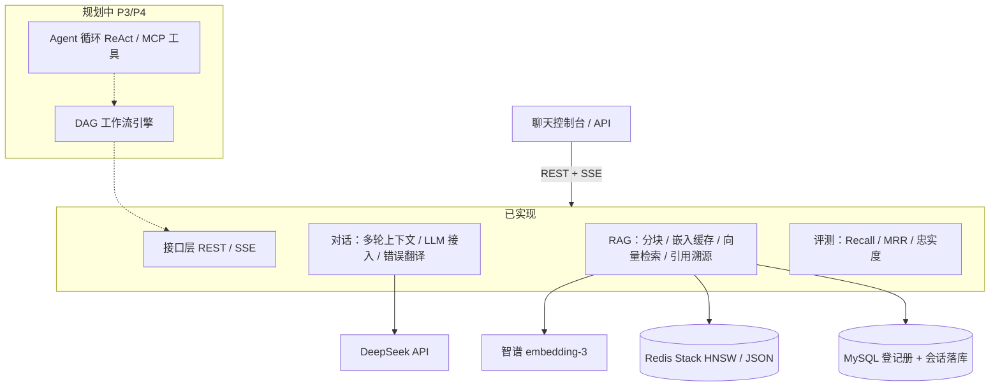

# AgentFlow · AI 流式对话与 RAG 检索平台

基于 Spring Boot 4 / JDK 21 的 AI 应用后端：SSE 流式对话、多轮会话上下文、生产级 RAG 检索链路（Redis Stack 向量检索 + 引用溯源），并以**自建评测集驱动检索调优**——所有指标可复现（`scripts/eval_rag.py`）。

不依赖 LangChain 等框架，核心链路手写。

## 已实现

### 对话闭环
- DeepSeek LLM 接入；上游错误统一翻译（401/402/403/404/429/5xx → 带指引的中文提示，阻塞与 SSE 两条路径一致）
- SSE 打字机式流式对话；多轮上下文（同会话稳定记忆、新会话相互隔离）
- 会话消息经 Spring Data JPA 落库 MySQL，**跨进程重启完整回放**（真实重启验证）
- 网页聊天控制台（原生 JS）：会话列表 / 切换 / 历史回放 / 知识库开关 / 引用来源卡片

### RAG 检索链路
- **文档上传**：Apache Tika 一套 API 解析 PDF/DOCX/TXT（按内容探测，不信任扩展名）
- **结构感知分块**：标题/段落边界切块 + 句边界回借重叠 + heading 元数据；固定滑窗双实现保留作对照基线
- **向量嵌入**：智谱 embedding-3（1024 维）；内容 hash 缓存——同文档重传**零重复嵌入**（实测 1540/1540 命中，4.4 秒完成、0 次 API 调用）
- **向量存储**（接口解耦，`@ConditionalOnProperty` 一行配置切换）：
  - Redis Stack（RediSearch）：Jedis 直写 `FT.CREATE`/`FT.SEARCH`，HNSW（M=16, EF_CONSTRUCTION=200）+ COSINE + FLOAT32，AOF 持久化，启动幂等建索引
  - JSON 文件 + 暴力余弦（评测基线保留）
- **引用溯源**：检索块编 `[n]` 注入 prompt，回答带引用编号；SSE 流末追加 `sources` 帧（ref/filename/chunkIdx/heading/score/snippet），控制台渲染来源卡片；知识库没有的内容如实回答"没有"

### 评测驱动调优
自建评测集：40 条锚定 QA + 3 条陷阱题（`docs/eval/evalset.json`），锚点句判定与分块策略解耦。复现：`python scripts/eval_rag.py search|faith|traps`，完整数据见 [docs/eval/RESULTS.md](docs/eval/RESULTS.md)。

**分块策略对比**（干净索引）：

| 分块策略 | Recall@5 | MRR@5 |
|---|---|---|
| 固定滑窗 · 15% 重叠 | 0.950 | 0.755 |
| 固定滑窗 · 0% 重叠 | 0.950 | 0.731 |
| 结构感知 · 15% 重叠 | 0.975 | 0.759 |
| **结构感知 · 0% 重叠** | **1.000** | **0.818** |

- 忠实度（LLM-as-judge）**4.80/5**（抽样 20 条）；陷阱题 **3/3 诚实拒绝**，零编造
- 千块级压测：1545 块 43 秒完成向量化入库；HNSW 检索 **p50=2ms / p95=4ms / p99=12ms**（100 次真实查询）
- **诚实结论**：这个量级暴力扫反而最快（无网络往返，p99=36ms 且主要是文件加载）；换 HNSW 买的是复杂度曲线（O(N×dim) → 近似 O(logN)）与数据生命周期解耦（AOF 重启恢复、多实例共享）
- 三条评测发现：① 语料稀释是第一杀手——混入 1545 块模板化干扰语料后 Recall@5 从 0.975 跌至 0.275，评测语料构成必须对齐生产；② 结构感知的真实优势是"不依赖重叠"（同 15% 重叠时两策略打平，0% 时拉开 8.7 个 MRR 点）；③ 重叠是双刃剑——修补边界但稀释块焦点

## 架构



## 功能路线（详见 [docs/roadmap.md](docs/roadmap.md)，含逐阶段验收记录与 38 条踩坑）

| 阶段 | 内容 | 状态 |
|---|---|---|
| P0 | 环境搭建 + 项目骨架 | ✅ |
| P1 | LLM 接入 + SSE 流式对话 + 多轮上下文 | ✅ |
| P2 | MySQL/Redis + RAG 管线（分块/向量检索/引用） | ✅ |
| P3 | 自研 DAG 工作流引擎 | ⬜ 规划中 |
| P4 | Agent 循环（ReAct / Function Calling）+ MCP | ⬜ 规划中 |
| P5 | 可观测 + 评测 + 压测 | 🟨 评测部分已提前完成 |
| P6 | 部署、文档、复盘 | ⬜ |

## 技术栈

Java 21 · Spring Boot 4.1 · Spring Data JPA · MySQL 8 · Redis Stack（RediSearch）· Jedis 8 · Apache Tika · DeepSeek API · 智谱 embedding-3 · SSE · Docker Compose · JUnit 5（单测 16 项）

## 快速开始

前置要求：**JDK 21**、Docker Desktop、API Key（DeepSeek 主对话 + 智谱 embedding）。

1. 在项目根目录创建 `application-local.yml`（已 gitignore，**严禁提交**），填入两个 key：

```yaml
LLM_API_KEY: sk-xxxx        # DeepSeek
ZHIPU_API_KEY: xxxxxxxx.xxxx  # 智谱
```

2. 启动：

```bash
docker compose up -d         # MySQL 8（宿主机端口 13306）+ Redis Stack（AOF）
./mvnw spring-boot:run       # Windows 用 mvnw.cmd
```

3. 浏览器打开 <http://localhost:8080/> 即聊天控制台（流式对话 / 多轮会话 / 知识库开关 / 来源卡片）；验证：

```bash
curl http://localhost:8080/api/ping          # {"code":0,"message":"ok",...}
curl http://localhost:8080/actuator/health   # {"status":"UP",...}
```

接口级测试用项目根的 `requests.http`（VS Code REST Client 插件）；评测复现：

```bash
python scripts/eval_rag.py search   # Recall@5 / MRR@5
python scripts/eval_rag.py faith    # 忠实度（LLM-as-judge）
python scripts/eval_rag.py traps    # 陷阱题拒答
```

## 目录结构

```
agentflow
├── docker-compose.yml          # MySQL 8 + Redis Stack（AOF）
├── requests.http               # 接口文档 / 测试用例
├── docs/
│   ├── roadmap.md              # 12 周路线图：任务、验收标准、进度日志、38 条踩坑
│   ├── eval/
│   │   ├── evalset.json        # 评测集（40 锚定 QA + 3 陷阱题）
│   │   └── RESULTS.md          # 评测完整数据
│   └── interview-prep.md       # （不入库）口述自测稿
├── scripts/eval_rag.py         # 评测脚本（search / faith / traps）
└── src/main/
    ├── java/com/agentflow/
    │   ├── common/             # 统一返回 Result、全局异常、上游错误翻译、访问日志
    │   ├── chat/               # 对话：LLM 客户端、SSE、多轮上下文、会话落库
    │   ├── rag/                # RAG：解析、分块、嵌入缓存、向量存储（Redis/JSON）、引用
    │   └── web/                # 演示页与接口
    └── resources/
        ├── application.yml
        └── static/index.html   # 聊天控制台（原生 JS，手写 SSE 帧解析）
```

## 文档

- [docs/roadmap.md](docs/roadmap.md) — 路线图与进度日志（每阶段"能跑 + 能讲"验收制，38 条踩坑记录）
- [docs/eval/RESULTS.md](docs/eval/RESULTS.md) — 评测方法与完整数据
